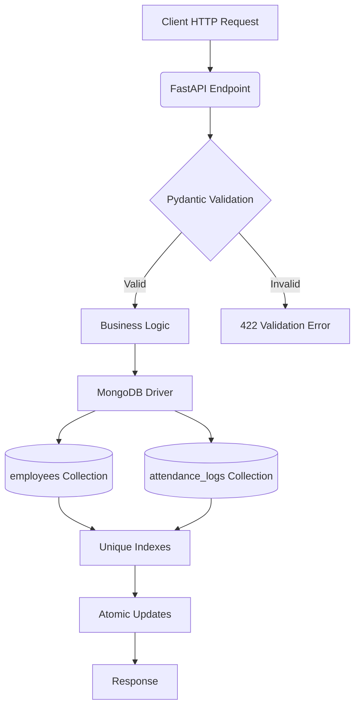

# Employee Attendance & Analytics API

A FastAPI-based backend service for tracking employee attendance, computing derived metrics (work hours, late minutes, overtime, half-day status), and providing analytics on employee and department-level attendance trends.

## Overview

This API solves the core HR problem of recording employee punch-in/punch-out events, validating them against business rules (R1-R10), maintaining an audit trail of manual corrections, and generating actionable attendance analytics. It enforces data integrity through Pydantic validation, MongoDB unique indexes, and atomic update operations to prevent race conditions.

## Technology Stack

- **Language**: Python 3.11+
- **Framework**: FastAPI 0.110+
- **Database**: MongoDB 6.0+ (via PyMongo 4.7+)
- **Data Validation**: Pydantic 2.6+
- **Environment Management**: python-dotenv 1.0+
- **ASGI Server**: Uvicorn[standard] 0.29+

## Core Capabilities

### Employee Management
- Create employees with unique `emp_code`, name, email, department, shift timings, and employment date
- List employees with pagination and optional department filtering

### Attendance Recording
- Record punch-in (with optional timestamp) – defaults to current time
- Record punch-out (with optional timestamp) – closes the most recent open punch-in
- Automatic computation of derived fields:
  - `late_minutes` (R2): minutes after shift start, with 10-minute grace period
  - `work_hours` (R4): hours between punch-in and punch-out, rounded half-up to 2 decimals
  - `overtime_minutes` (R3): minutes after shift end, counted only if ≥30
  - `half_day` (R5): true when `work_hours` < 4.50

### Manual Corrections (Regularization)
- Update any field (`status`, `punch_in`, `punch_out`) on an existing attendance record
- Automatic recomputation of all derived fields after changes
- Audit trail (`history`) capturing who, when, why, and what changed
- Prevention of no-op changes and race conditions via conditional updates

### Analytics & Reporting
- **Employee Monthly Summary**: present days, leave days, late counts, late/overtime minutes, attendance percentage
- **Department Summary (Monthly)**: headcount, total present days, average work hours, late/leave/on-duty counts
- **Late Leaderboard**: ranking of employees by total late minutes (standard competition ranking)
- **Department Trend (Daily)**: daily present count, headcount, attendance rate, and 7-day moving average of attendance rate
- **Admin Explain**: MongoDB query execution plans for all endpoints (useful for performance tuning)

### Data Integrity & Safety
- Unique indexes prevent duplicate employees and duplicate attendance records
- All write operations use atomic MongoDB updates to avoid lost updates
- Input validation rejects invalid data types (strings where integers expected, out-of-range timestamps, impossible dates)
- Business rules (R1-R10) enforced at both API and database levels

## Architecture Overview



## Repository Structure

| File/Directory | Purpose |
|----------------|---------|
| `app/main.py` | Contains all API endpoints, business logic, helper functions, and MongoDB setup |
| `requirements.txt` | Python package dependencies for local development |
| `openapi.yaml` | Authoritative API contract and business rules (R1-R10) |
| `DATA_MODEL.md` | Description of MongoDB collections, fields, and sample document structures |
| `DECISIONS.md` | Engineering decisions made during implementation (indexes, race handling, etc.) |
| `REVIEW.md` | Defects found and corrected during development |
| `sample_seed.py` | Script to load sample data into MongoDB for development/testing |
| `sample_data/` | MongoDB Extended JSON files with nine sample documents |
| `.gitignore` | Files and directories to exclude from version control |

## Prerequisites

- Python 3.11 or higher
- MongoDB 6.0 or higher (MongoDB Atlas or local instance)
- Git (for cloning the repository)

## Local Setup (Windows Command Prompt)

```cmd
:: Clone the repository
git clone https://github.com/mahesh515865/employee-attendance-analytics-api.git
cd employee-attendance-analytics-api

:: Create and activate virtual environment
python -m venv .venv
.venv\Scripts\activate

:: Install dependencies
pip install -r requirements.txt

:: Set environment variables (adjust if using MongoDB Atlas)
set MONGO_URI=mongodb://localhost:27017
set MONGO_DB=attendance_db

:: Load sample data
python sample_seed.py

:: Start the API server
uvicorn app.main:app --port 8000 --reload
```

## Local Setup (PowerShell)

```powershell
# Clone the repository
git clone https://github.com/mahesh515865/employee-attendance-analytics-api.git
cd employee-attendance-analytics-api

# Create and activate virtual environment
python -m venv .venv
.\.venv\Scripts\Activate.ps1

# Install dependencies
pip install -r requirements.txt

# Set environment variables (adjust if using MongoDB Atlas)
$env:MONGO_URI = "mongodb://localhost:27017"
$env:MONGO_DB = "attendance_db"

# Load sample data
python sample_seed.py

# Start the API server
uvicorn app.main:app --port 8000 --reload
```

## Environment Variables

| Variable | Description | Example | Required |
|----------|-------------|---------|----------|
| `MONGO_URI` | MongoDB connection string | `mongodb://localhost:27017` | No (defaults to `mongodb://localhost:27017`; set only for non-local instances, e.g., MongoDB Atlas) |
| `MONGO_DB` | Database name | `attendance_db` | No (defaults to `attendance_db`; set only to use a different database) |

> **Note**: The API reads `MONGO_URI` and `MONGO_DB` from environment variables, falling back to the defaults shown above. You only need to set them if you want to override the defaults (e.g., to connect to a MongoDB Atlas cluster or a different database name). Do not commit `.env` files containing credentials. Use environment variables or a `.env` file locally (listed in `.gitignore`).

## Database Initialization

The API automatically creates required indexes on startup:
- `employees.emp_code` (unique)
- `employees.joined_on`
- `employees.department`
- `attendance_logs.emp_code_1_date_1` (unique compound index)
- `attendance_logs.date_-1_emp_code_1` (for recent-first queries)

Sample data can be loaded at any time using the provided seed script:
```cmd
python sample_seed.py
```

## Starting the API

After setting environment variables and (optionally) loading sample data:

```cmd
uvicorn app.main:app --port 8000 --reload
```

The API will be available at `http://localhost:8000`.

## Health Check

Verify the API is running and can connect to MongoDB:

```cmd
curl http://localhost:8000/health
```

Expected response:
```json
{"status":"ok"}
```

## Interactive API Documentation

Once the server is running:
- Swagger UI: http://localhost:8000/docs
- ReDoc: http://localhost:8000/redoc
- OpenAPI JSON: http://localhost:8000/openapi.json

## API Endpoint Reference

### Employees
| Method | Endpoint | Description |
|--------|----------|-------------|
| POST | `/employees` | Create a new employee |
| GET | `/employees` | List employees (with pagination, optional department filter) |

### Attendance
| Method | Endpoint | Description |
|--------|----------|-------------|
| POST | `/attendance/punch-in` | Record a punch-in event |
| POST | `/attendance/punch-out` | Record a punch-out event |
| GET | `/attendance` | List attendance records (with filtering and pagination) |
| PATCH | `/attendance/{emp_code}/{date}` | Regularize (manually correct) an attendance record |

### Analytics
| Method | Endpoint | Description |
|--------|----------|-------------|
| GET | `/analytics/employees/{emp_code}/monthly` | Monthly summary for a specific employee |
| GET | `/analytics/departments/summary` | Department-level summary for a month |
| GET | `/analytics/leaderboard/late` | Leaderboard of employees by total late minutes |
| GET | `/analytics/departments/{department}/trend` | Daily attendance trend for a department |

### Administration
| Method | Endpoint | Description |
|--------|----------|-------------|
| GET | `/admin/explain/{endpoint}` | MongoDB explain output for an endpoint's main query |

## Request and Response Examples

### Create Employee
**Request**
```json
POST /employees
{
  "emp_code": "EMP0007",
  "name": "John Doe",
  "email": "john.doe@example.com",
  "department": "Engineering",
  "joined_on": "2026-10-01"
}
```

**Response** (201 Created)
```json
{
  "emp_code": "EMP0007",
  "name": "John Doe",
  "email": "john.doe@example.com",
  "department": "Engineering",
  "shift_start": "09:30",
  "shift_end": "18:30",
  "joined_on": "2026-10-01",
  "created_at": 1783312500000
}
```

### Punch In
**Request**
```json
POST /attendance/punch-in
{
  "emp_code": "EMP0007"
}
```

**Response** (201 Created)
```json
{
  "emp_code": "EMP0007",
  "date": "2026-10-01",
  "status": "PRESENT",
  "punch_in": 1783312500000,
  "punch_out": null,
  "work_hours": null,
  "late_minutes": 0,
  "overtime_minutes": 0,
  "half_day": false,
  "history": []
}
```

### Punch Out
**Request**
```json
POST /attendance/punch-out
{
  "emp_code": "EMP0007",
  "punched_at": 1783348500000
}
```

**Response** (200 OK)
```json
{
  "emp_code": "EMP0007",
  "date": "2026-10-01",
  "status": "PRESENT",
  "punch_in": 1783312500000,
  "punch_out": 1783348500000,
  "work_hours": 10.0,
  "late_minutes": 0,
  "overtime_minutes": 0,
  "half_day": false,
  "history": []
}
```

### Regularize Attendance
**Request**
```json
PATCH /attendance/EMP0007/2026-10-01
{
  "status": "WFH",
  "regularized_by": "john.doe",
  "reason": "Working from home approved"
}
```

**Response** (200 OK)
```json
{
  "emp_code": "EMP0007",
  "date": "2026-10-01",
  "status": "WFH",
  "punch_in": 1783312500000,
  "punch_out": 1783348500000,
  "work_hours": 10.0,
  "late_minutes": 0,
  "overtime_minutes": 0,
  "half_day": false,
  "history": [
    {
      "at": 1783352100000,
      "by": "john.doe",
      "reason": "Working from home approved",
      "changes": {
        "status": {
          "from": "PRESENT",
          "to": "WFH"
        }
      }
    }
  ]
}
```

### Employee Monthly Summary
**Request**
```http
GET /analytics/employees/EMP0007/monthly?month=2026-10
```

**Response** (200 OK)
```json
{
  "emp_code": "EMP0007",
  "month": "2026-10",
  "working_days": 23,
  "present_days": 1.0,
  "leave_days": 0,
  "late_count": 0,
  "total_late_minutes": 0,
  "total_overtime_minutes": 0,
  "attendance_pct": 4.35
}
```

## Attendance Business Rules (R1-R10)

All rules are enforced by the API as defined in `openapi.yaml`:

- **R1**: Time zone and attendance date – All instants are in UTC; attendance date is derived in IST (UTC+5:30)
- **R2**: Late minutes – Grace period of 10 minutes; `late_minutes` = floor(minutes after shift start) if >10, else 0
- **R3**: Overtime minutes – `overtime_minutes` = floor(minutes after shift end) if ≥30, else 0
- **R4**: Work hours – `(punch_out - punch_in) / 3600`, rounded half-up to 2 decimal places
- **R5**: Half day – `half_day` = true when `work_hours` < 4.50
- **R6**: Presence – `PRESENT`, `WFH`, and `ON_DUTY` count as present; `ABSENT` and `LEAVE` do not
- **R7**: Working days – Monday–Friday only; for mid-month hires, working days start from `joined_on`
- **R8**: Rounding – 2 decimals half-up for reported numbers; 4 decimals half-up for rates
- **R9**: Headcount – Employees with `joined_on` ≤ period end date are counted
- **R10**: Pagination – `page` starts at 1; `page_size` max 100; `total` reflects filtered count

## MongoDB Data Model and Indexing

See [DATA_MODEL.md](DATA_MODEL.md) for complete details on stored collections and field types.

### Indexes Created at Startup
- `employees.emp_code` (unique) – prevents duplicate employee codes
- `employees.joined_on` – supports `joined_on ≤ month_end` filter in department summary
- `employees.department` – supports department lookup in department trend endpoint
- `attendance_logs.emp_code_1_date_1` (unique compound) – ensures at most one attendance record per employee per date
- `attendance_logs.date_-1_emp_code_1` – optimizes recent-first queries in attendance listing

## Analytics Behavior and Limitations

- Analytics endpoints **read stored derived values** (`work_hours`, `late_minutes`, etc.) and do not recompute from punch times
- Department summary includes employees with zero logs (they contribute to headcount but not to present days or work hours)
- Late leaderboard uses standard competition ranking (ties share rank; next rank skipped)
- Department trend includes all calendar days in the requested range, even those with no records (attendance rate = 0.0 on working days with headcount > 0)
- Moving average of 7 days (`moving_avg_7d`) is calculated as the sum of non-null `attendance_rate` values in the window (current day and up to 6 preceding days, limited to the requested range) divided by the count of those days; if the count is zero, the value is `null`.

## Validation and Error Handling

- All input data is validated by Pydantic models; invalid requests return HTTP 422 with detailed error messages
- Business rule violations (e.g., setting `punch_in` on a different date, `punch_out` before `punch_in`) return HTTP 422
- Resource conflicts (duplicate employee code, duplicate attendance record) return HTTP 409
- Missing resources (unknown employee, missing attendance record) return HTTP 404
- Database connectivity issues return HTTP 503

## Testing and Verification

### Manual Verification Steps
1. Start the API as described above
2. Use the interactive docs at http://localhost:8000/docs to test endpoints
3. Verify health endpoint returns `{"status":"ok"}`
4. Create an employee, record punch-in/punch-out, and check derived fields
5. Attempt invalid operations (e.g., punch-in for non-existent employee) and verify appropriate error codes
6. Load sample data and run analytics endpoints to inspect outputs

### Automated Checks
- Run `python -m py_compile app/main.py` to verify no syntax errors
- Visual inspection of code logic against business rules

> **Note**: This repository does not include an automated test suite. Verification is manual via the API interface.

## Engineering Decisions and Review Notes

- See [DECISIONS.md](DECISIONS.md) for Indexing strategy, punch-in race handling, tie-breaking in leaderboards, headcount calculation, and scalability considerations.
- See [REVIEW.md](REVIEW.md) for defects found and corrected during development (e.g., joined_on validation, punched_at type validation, history timestamp truncation).

## Troubleshooting

| Symptom | Likely Cause | Solution |
|---------|--------------|----------|
| `Database unavailable` (503) | MongoDB not running or wrong connection string | Verify MongoDB service is running; check `MONGO_URI` and `MONGO_DB` |
| `emp_code already exists` (409) | Duplicate employee code | Use a unique `emp_code` |
| `Attendance record already exists` (409) | Duplicate punch-in for same employee/date | Ensure no existing record for the employee and date |
| `Invalid month format` (422) | Month not in YYYY-MM format | Use format like `2026-10` |
| `Invalid date format` (422) | Date not in YYYY-MM-DD format | Use format like `2026-10-01` |
| `Request changes nothing` (422) | Patch request with no actual changes | Ensure at least one field differs from current value |
| `Record already updated by another request` (409) | Concurrent modification | Retry the operation; the first updater wins |

## Security Considerations, Limitations, and Future Improvements

### Limitations
- No authentication or authorization – intended for trusted environments only
- No rate limiting – could be abused under high load
- Audit trail (`history`) stores only manual corrections; punch-in/punch-out events are not tracked
- Moving average calculation in department trend uses a simplified algorithm (not a true exponential moving average)

### Possible Future Improvements
- Add JWT-based authentication and role-based access control
- Implement rate limiting using middleware
- Store punch-in/punch-out events in history for complete audit trail
- Add experimental endpoints for real-time attendance monitoring
- Containerize the application with Docker for easier deployment
- Add CI/CD pipeline with automated testing (when test suite is developed)
- Implement OLAP-style pre-aggregation for improved analytics performance at scale

## Conclusion

This API provides a solid foundation for an employee attendance tracking system, correctly implementing the specified business rules (R1-R10) with attention to data integrity, race condition prevention, and clear separation of concerns. The code is contained in a single file (`app/main.py`) for simplicity, yet follows best practices for validation, error handling, and database operations. With proper deployment considerations (authentication, TLS, monitoring), it can serve as a reliable backend for HR attendance management.

---
*Last updated: 2026-10-13*