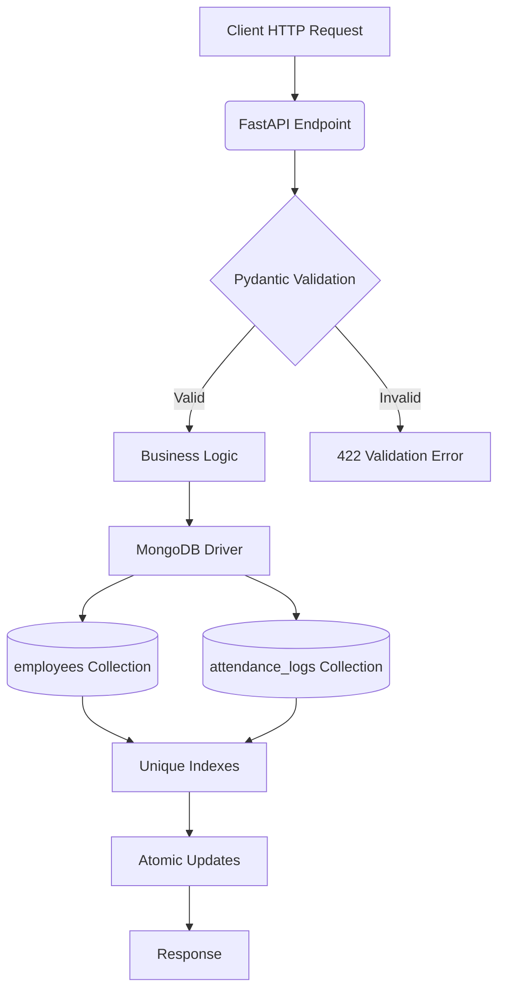

# Employee Attendance & Analytics API
FastAPI backend for employee attendance tracking with punch-in/punch-out, derived metrics (work hours, late minutes, overtime, half-day), and analytics.

## Technology Stack

- Python 3.11+
- FastAPI 0.110+
- MongoDB 6.0+ (PyMongo 4.7+)
- Pydantic 2.6+
- python-dotenv 1.0+
- Uvicorn[standard] 0.29+

## Core Capabilities

- Employee management (create, list)
- Attendance recording (punch-in/punch-out with automatic derived fields)
- Manual corrections (regularization) with audit trail
- Analytics: employee monthly summary, department summary, late leaderboard, department trend
- Admin explain endpoint for MongoDB query plans
- Data integrity via unique indexes and atomic updates
- Input validation and business rule enforcement (R1-R10)

## Architecture Overview



## Repository Structure

- `app/main.py` – API endpoints, business logic, helpers, MongoDB setup
- `requirements.txt` – Python dependencies
- `openapi.yaml` – API contract and business rules (R1-R10)
- `DATA_MODEL.md` – MongoDB collections and fields
- `DECISIONS.md` – Engineering decisions (indexes, race handling, etc.)
- `REVIEW.md` – Defects fixed during development
- `sample_seed.py` – Load sample data into MongoDB
- `sample_data/` – Sample employee and attendance logs (MongoDB Extended JSON)
- `.gitignore` – Excluded files/directories

## Prerequisites

- Python 3.11 or higher
- MongoDB 6.0 or higher (local or Atlas)
- Git (for cloning the repository)

## Setup (Windows)

### Command Prompt
```cmd
git clone https://github.com/mahesh515865/employee-attendance-analytics-api.git
cd employee-attendance-analytics-api
python -m venv .venv
.venv\Scripts\activate
pip install -r requirements.txt
set MONGO_URI=mongodb://localhost:27017
set MONGO_DB=attendance_db
python sample_seed.py
uvicorn app.main:app --port 8000 --reload
```

### PowerShell
```powershell
git clone https://github.com/mahesh515865/employee-attendance-analytics-api.git
cd employee-attendance-analytics-api
python -m venv .venv
.\.venv\Scripts\Activate.ps1
pip install -r requirements.txt
$env:MONGO_URI = "mongodb://localhost:27017"
$env:MONGO_DB = "attendance_db"
python sample_seed.py
uvicorn app.main:app --port 8000 --reload
```

## Environment Variables

| Variable | Description | Example | Required |
|----------|-------------|---------|----------|
| `MONGO_URI` | MongoDB connection string | `mongodb://localhost:27017` | No (defaults to localhost) |
| `MONGO_DB` | Database name | `attendance_db` | No (defaults to attendance_db) |

Defaults are used if variables are not set. Override for non‑local instances (e.g., MongoDB Atlas).

## Database Initialization

On startup, the API creates the following indexes:
- `employees.emp_code` (unique)
- `employees.joined_on`
- `employees.department`
- `attendance_logs.emp_code_1_date_1` (unique compound)
- `attendance_logs.date_-1_emp_code_1` (recent‑first queries)

Load sample data at any time:
```cmd
python sample_seed.py
```

## API Documentation

Once the server is running:
- Swagger UI: http://localhost:8000/docs
- ReDoc: http://localhost:8000/redoc
- OpenAPI JSON: http://localhost:8000/openapi.json

## Endpoint Reference

### Employees
- `POST /employees` – Create a new employee
- `GET /employees` – List employees (pagination, optional department filter)

### Attendance
- `POST /attendance/punch-in` – Record a punch‑in event
- `POST /attendance/punch-out` – Record a punch‑out event
- `GET /attendance` – List attendance records (filtering and pagination)
- `PATCH /attendance/{emp_code}/{date}` – Regularize (manually correct) an attendance record

### Analytics
- `GET /analytics/employees/{emp_code}/monthly` – Monthly summary for a specific employee
- `GET /analytics/departments/summary` – Department‑level summary for a month
- `GET /analytics/leaderboard/late` – Leaderboard of employees by total late minutes
- `GET /analytics/departments/{department}/trend` – Daily attendance trend for a department

### Administration
- `GET /admin/explain/{endpoint}` – MongoDB explain output for an endpoint's main query

## Request and Response Examples

### Create Employee
**Request**
```json
POST /employees
{
  "emp_code": "EMP0007",
  "name": "John Doe",
  "email": "john.doe@example.com",
  "department": "Engineering",
  "joined_on": "2026-10-01"
}
```
**Response** (201 Created)
```json
{
  "emp_code": "EMP0007",
  "name": "John Doe",
  "email": "john.doe@example.com",
  "department": "Engineering",
  "shift_start": "09:30",
  "shift_end": "18:30",
  "joined_on": "2026-10-01",
  "created_at": 1790769600000
}
```

### Punch In
**Request**
```json
POST /attendance/punch-in
{
  "emp_code": "EMP0007"
}
```
**Response** (201 Created)
```json
{
  "emp_code": "EMP0007",
  "date": "2026-10-01",
  "status": "PRESENT",
  "punch_in": 1790827200000,
  "punch_out": null,
  "work_hours": null,
  "late_minutes": 0,
  "overtime_minutes": 0,
  "half_day": false,
  "history": []
}
```

### Punch Out
**Request**
```json
POST /attendance/punch-out
{
  "emp_code": "EMP0007",
  "punched_at": 1790859600000
}
```
**Response** (200 OK)
```json
{
  "emp_code": "EMP0007",
  "date": "2026-10-01",
  "status": "PRESENT",
  "punch_in": 1790827200000,
  "punch_out": 1790859600000,
  "work_hours": 9.0,
  "late_minutes": 0,
  "overtime_minutes": 0,
  "half_day": false,
  "history": []
}
```

## Attendance Business Rules (R1-R10)

All rules are enforced by the API as defined in `openapi.yaml`:
- **R1**: Time zone and attendance date – All instants are in UTC; attendance date is derived in IST (UTC+5:30)
- **R2**: Late minutes – Grace period of 10 minutes; `late_minutes` = floor(minutes after shift start) if >10, else 0
- **R3**: Overtime minutes – `overtime_minutes` = floor(minutes after shift end) if ≥30, else 0
- **R4**: Work hours – `(punch_out - punch_in) / 3600`, rounded half‑up to 2 decimal places
- **R5**: Half day – `half_day` = true when `work_hours` < 4.50
- **R6**: Presence – `PRESENT`, `WFH`, and `ON_DUTY` count as present; `ABSENT` and `LEAVE` do not
- **R7**: Working days – Monday–Friday only; for mid‑month hires, working days start from `joined_on`
- **R8**: Rounding – 2 decimals half‑up for reported numbers; 4 decimals half‑up for rates
- **R9**: Headcount – Employees with `joined_on` ≤ period end date are counted
- **R10**: Pagination – `page` starts at 1; `page_size` max 100; `total` reflects filtered count

## Analytics Behavior and Limitations

- Analytics endpoints **read stored derived values** (`work_hours`, `late_minutes`, etc.) and do not recompute from punch times
- Department summary includes employees with zero logs (they contribute to headcount but not to present days or work hours)
- Late leaderboard uses standard competition ranking (ties share rank; next rank skipped)
- Department trend includes all calendar days in the requested range, even those with no records (attendance rate = 0.0 on working days with headcount > 0)
- Moving average of 7 days (`moving_avg_7d`) is calculated as the sum of non‑null `attendance_rate` values in the window (current day and up to 6 preceding days, limited to the requested range) divided by the count of those days; if the count is zero, the value is `null`.

## Testing and Verification

### Manual Verification Steps
1. Start the API as described above
2. Use the interactive docs at http://localhost:8000/docs to test endpoints
3. Verify health endpoint returns `{"status":"ok"}`
4. Create an employee, record punch‑in/punch‑out, and check derived fields
5. Attempt invalid operations (e.g., punch‑in for non‑existent employee) and verify appropriate error codes
6. Load sample data and run analytics endpoints to inspect outputs

### Automated Checks
- Run `python -m py_compile app/main.py` to verify no syntax errors
- Visual inspection of code logic against business rules

> **Note**: This repository does not include an automated test suite. Verification is manual via the API interface.

## Engineering Decisions and Review Notes

- See `DECISIONS.md` for indexing strategy, punch‑in race handling, tie‑breaking in leaderboards, headcount calculation, and scalability considerations.
- See `REVIEW.md` for defects found and corrected during development (e.g., `joined_on` validation, `punched_at` type validation, history timestamp truncation).

## Troubleshooting

| Symptom | Likely Cause | Solution |
|---------|--------------|----------|
| `Database unavailable` (503) | MongoDB not running or wrong connection string | Verify MongoDB service is running; check `MONGO_URI` and `MONGO_DB` |
| `emp_code already exists` (409) | Duplicate employee code | Use a unique `emp_code` |
| `Attendance record already exists` (409) | Duplicate punch‑in for same employee/date | Ensure no existing record for the employee and date |
| `Invalid month format` (422) | Month not in YYYY‑MM format | Use format like `2026-10` |
| `Invalid date format` (422) | Date not in YYYY‑MM‑DD format | Use format like `2026-10-01` |
| `Request changes nothing` (422) | Patch request with no actual changes | Ensure at least one field differs from current value |
| `Record already updated by another request` (409) | Concurrent modification | Retry the operation; the first updater wins |

## Limitations

- No authentication or authorization – intended for trusted environments only
- No rate limiting – could be abused under high load
- Audit trail (`history`) stores only manual corrections; punch‑in/punch‑out events are not tracked
- Moving average calculation in department trend uses a simplified algorithm (not a true exponential moving average)

## Conclusion
This API provides a foundation for employee attendance tracking, implementing the specified business rules (R1–R10) with attention to data integrity, concurrency handling, and validation. The application keeps its API logic in `app/main.py` for simplicity. Before production deployment, add appropriate authentication, monitoring, and operational safeguards.